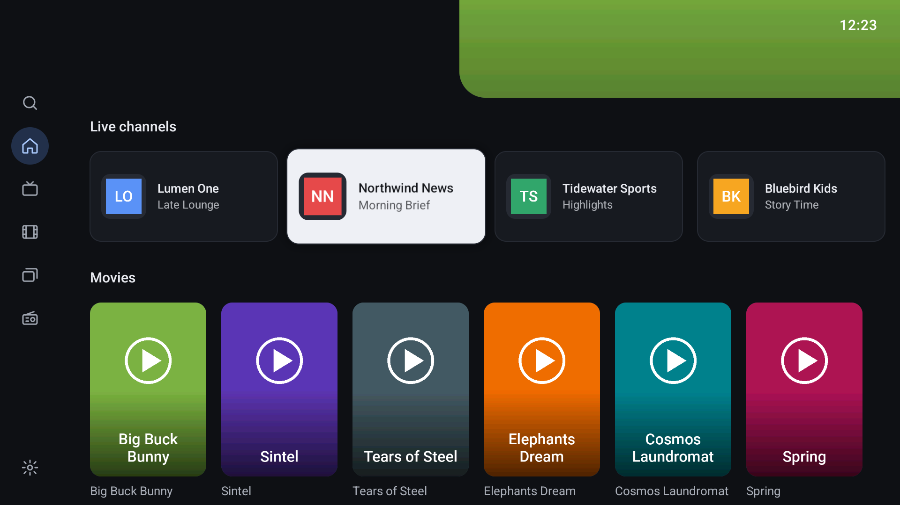
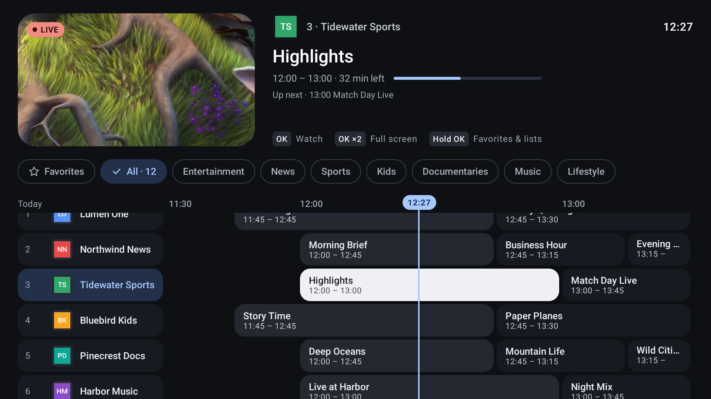
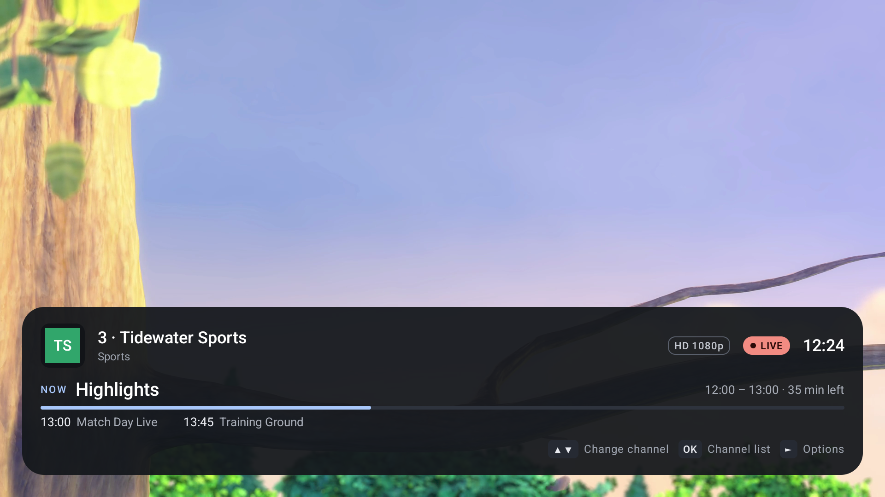
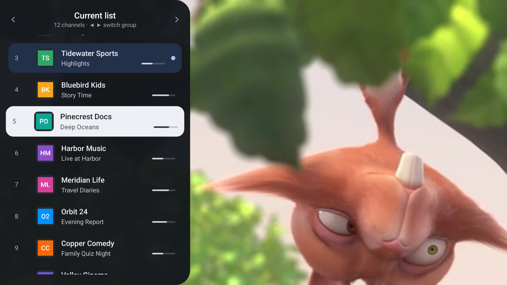
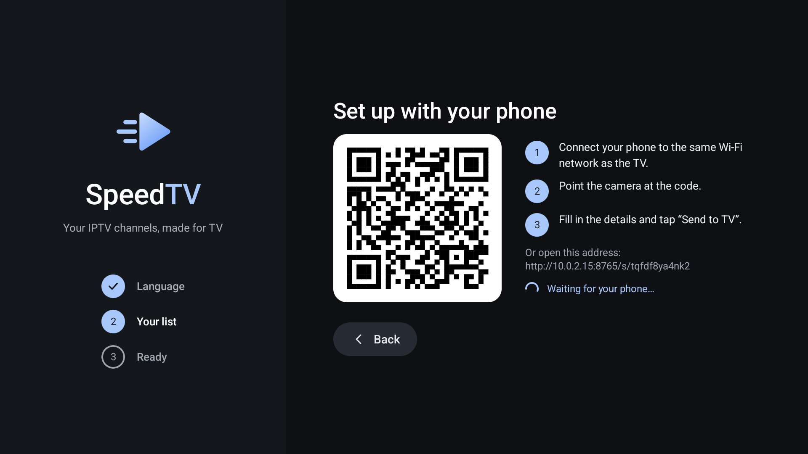

# SpeedTV

**A fast, clean IPTV player built for Android TV and the remote control.**

SpeedTV turns your own IPTV subscription into a proper TV experience. You get live channels with a TV guide, movies, series and radio, all in one place and easy to use from the couch. It starts quickly, switches channels fast, and plays the formats that cheap TV boxes often struggle with.

> **SpeedTV is a player only.** It doesn't provide, sell or recommend any channels or content. You need a playlist from your own provider (an M3U link or an Xtream Codes account).

## Features

### Easy setup
- **Set up from your phone:** scan a QR code on the TV and type your playlist details on your phone instead of with the remote.
- **Connection check before loading**, with clear messages for a wrong password, an expired account or a wrong address.
- **Xtream links are detected automatically**, so movies, series and the TV guide come along.
- Several playlists (profiles), each with its own settings.

### Made for TV
- Live TV, movies, series and radio in one place.
- **TV guide (EPG)** with what's on now and next.
- Favorites and your own custom lists.
- Quick channel switching with the remote (Up/Down or CH+/CH−, or type the channel number) and a channel list over the picture.
- **Multiview:** watch two channels at once.
- Search across everything.
- Resume movies and episodes where you left off.

### Playback
- Hardware decoding with automatic software fallback for streams the TV can't decode.
- MP2, AC3, E-AC3 and DTS audio support (FFmpeg).
- HLS quality options, buffer presets and display refresh-rate matching.
- Audio track and subtitle selection.

### Private and safe
- Parental control with a PIN and locked categories.
- No ads, no accounts, no tracking.
- Your playlists and passwords stay on your TV. See the [privacy policy](https://gist.github.com/cruz-py/960da5f83a9266b0a5e02fdb1da9e0a0).

Available in English, Spanish, French, German, Italian, Portuguese, Brazilian Portuguese, Turkish and Arabic.

## Screenshots

| | |
|---|---|
|  |  |
|  |  |

## Install

- **Google Play:** coming soon.
- **APK:** download the latest version from [Releases](https://github.com/cruz-py/SpeedTV-app/releases) and install it on your Android TV (Android 7.0 or newer).

## Getting started

1. Open SpeedTV and choose **Use your phone** (scan the QR code) or type your details with the remote.
2. Enter your M3U link or your Xtream Codes server, username and password.
3. SpeedTV checks the connection, loads your channels and guide, and you're ready to watch.

## Support the project

SpeedTV is free, with no ads and no tracking, and it's made in my spare time. If you enjoy it and want to help with its development, you can buy me a coffee:

**[Donate with PayPal](https://www.paypal.com/paypalme/ruicruz27)**

Bug reports and ideas are welcome in [Issues](https://github.com/cruz-py/SpeedTV-app/issues).

## Open-source components

SpeedTV is closed source. It uses these open-source libraries:

- **AndroidX Media3** (Apache License 2.0) for playback.
- **FFmpeg 6.0** (GNU LGPL 2.1 or later) for MP2, AC3, E-AC3 and DTS audio. The exact version, the licence notice and the script to rebuild the FFmpeg library used by the app are in [`ffmpeg/`](ffmpeg/).
